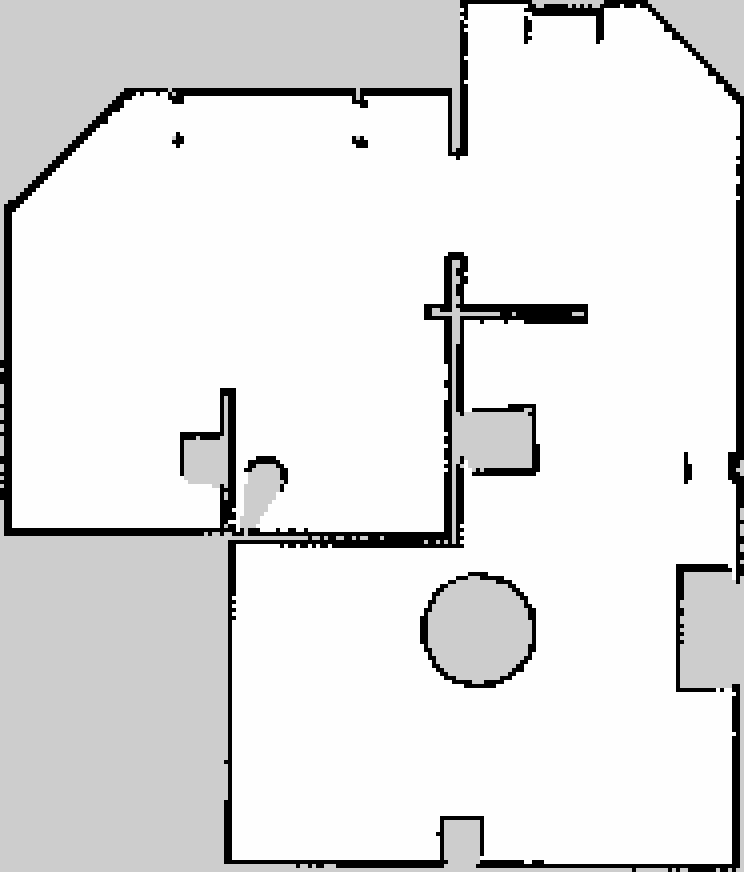

# TIAGo Autonomous Exploration

Frontier-based autonomous exploration and occupancy-grid mapping with **ROS 2 Humble, Gazebo, SLAM Toolbox, and Nav2**.

This academic project connects an exploration decision node to an existing TIAGo simulation and navigation stack. The node detects frontiers, chooses a reachable goal in known free space, waits for navigation to finish, and reassesses the updated map. It requests automatic map saving when its stopping criterion is met.

**Author:** Mahsa Ebrahimibavil  
**Scope:** Task 1 - exploration and mapping in simulation. Pick-and-place manipulation is outside this repository's demonstrated scope.

## Demonstration

[Watch the 56.5-second demonstration](media/demo.mp4) - Gazebo alongside RViz; exploration is accelerated to 6x, with a normal-speed ending.



The included map was saved during the 16 October 2026 recording run. Its resolution is **0.05 m/cell** and its dimensions are **186 x 218 cells**. The preview is enlarged using nearest-neighbour interpolation; the original PGM and YAML are in `maps/`.

The video shows navigation and map growth. It does not show the terminal completion or map-save messages. The saved map pair is included as a separate result. No coverage percentage, real-robot validation, or optimality claim is made.

## How the algorithm works

1. **Detect frontiers:** find free cells (`0`) touching unknown cells (`-1`) in an eight-connected neighbourhood of `/map`.
2. **Group cells:** use breadth-first search to form eight-connected frontier clusters; discard clusters with fewer than five cells.
3. **Construct candidate goals:** choose the cluster cell nearest its mean position. Estimate the local direction toward unknown space and search inward into known free space for a stand-off target.
4. **Filter candidates:** require a known-free neighbourhood around the target and exclude regions close to previously visited or failed frontier locations. Consider at most five candidates, starting with the largest clusters.
5. **Check paths:** request `ComputePathToPose` from Nav2. The current implementation treats a returned path with at least two poses as reachable and sums its segment lengths.
6. **Rank reachable goals:** maximize `cluster_size / (1 + path_length)`. This is a heuristic balancing frontier size and travel distance, not a formal information-gain objective.
7. **Navigate and reassess:** send the selected pose through `NavigateToPose`, record success or failure, and analyse the map again.
8. **Finish and save:** after three consecutive analysis rounds with no eligible reachable candidate, stop selecting goals and request `/map_saver/save_map`.

The stand-off neighbourhood check is an occupancy-grid filter, not a full robot-footprint safety proof. Nav2's own costmaps and controller handle navigation obstacle avoidance.

## Responsibilities of each component

| Component | Responsibility |
|---|---|
| `frontier_explorer.py` | Frontier clustering, candidate filtering, path requests, goal scoring, navigation requests, stopping and map-save request |
| SLAM Toolbox | Pose estimation and occupancy-map updates from laser measurements |
| Nav2 | Global path planning, local motion control and navigation behaviours |
| Gazebo and TIAGo packages | Robot model, simulated sensors, controllers and world |
| RViz | Map, scan, robot and planned-path visualization |

## Requirements and repository boundary

This is a **project package for an existing TIAGo workspace**, not a complete standalone distribution of TIAGo or the example world.

The supplied launch files require packages including:

- `tiago_exam_worlds`, including its `example` world and launch resources;
- `tiago_bringup`, `tiago_description`, `tiago_2dnav`, and `tiago_moveit_config`;
- PAL, PMB2 and gripper packages referenced by the TIAGo launch files;
- ROS 2 Humble, Gazebo Classic and Gazebo ROS integration;
- Nav2, SLAM Toolbox, `rclpy`, `nav_msgs`, `nav2_msgs`, `tf2_ros`, `control_msgs`, and `trajectory_msgs`;
- Cyclone DDS for the configuration used here.

The dependency workspace used in the demonstration is **not bundled** and its complete source revision set was not supplied. Consequently, this repository alone does not establish a reproducible installation on a clean machine. Use the already provisioned TIAGo environment or supply its matching dependencies before building.

PAL Robotics upstream simulation: https://github.com/pal-robotics/tiago_simulation

## Build in an existing TIAGo environment

Use a separate overlay so the original working workspace remains intact. Source the existing dependency workspace first. The paths below match the demonstrated server; adapt them on another machine.

```bash
source /opt/ros/humble/setup.bash
source /home/ml/tiago_exam_2025_ws/install/setup.bash

mkdir -p ~/tiago_exploration_overlay/src
cd ~/tiago_exploration_overlay/src
git clone https://github.com/ebrahimi-mahsa/tiago-autonomous-exploration.git

cd ~/tiago_exploration_overlay
colcon build --packages-select tiago_exam --symlink-install
source install/setup.bash
```

The package retains its original name, `tiago_exam`; the overlay overrides the underlay's package. Review any colcon override warning. Do not build a second copy alongside an existing `tiago_exam` source package in the same workspace.

Only Python syntax, XML parsing, map consistency and archive contents were checked during repository packaging. A ROS build and end-to-end simulation were not rerun in the packaging environment.

## Run Task 1

In **each server terminal**, source the dependency environment and the new overlay:

```bash
source /opt/ros/humble/setup.bash
source /home/ml/tiago_exam_2025_ws/install/setup.bash
source ~/tiago_exploration_overlay/install/setup.bash
export RMW_IMPLEMENTATION=rmw_cyclonedds_cpp
```

### Terminal 1 - simulation

```bash
vglrun -d egl ros2 launch tiago_exam tiago_exam.launch.py \
  world_name:=example \
  moveit:=false
```

Wait for the robot and controllers to initialize.

### Terminal 2 - navigation and fresh SLAM

```bash
vglrun -d egl ros2 launch tiago_2dnav tiago_nav_bringup.launch.py \
  is_public_sim:=True \
  world_name:=example \
  slam:=True
```

Wait for navigation's `Managed nodes are active`, a map in RViz, and valid transforms. Keep both launch terminals running.

`vglrun -d egl` is the GPU-rendering solution tested on the remote NVIDIA L40 / TurboVNC server. On a local desktop with working OpenGL, the ROS launch may be run without that prefix. It is not a universal ROS requirement.

### Terminal 3 - exploration and unique map filename

Start screen recording before this step if making a demonstration.

```bash
mkdir -p "$HOME/tiago_maps"
task1_map="$HOME/tiago_maps/task1_$(date +%Y%m%d_%H%M%S)"
echo "Map destination: $task1_map"

ros2 run tiago_exam frontier_explorer.py --ros-args \
  -p use_sim_time:=true \
  -p map_url:="$task1_map"
```

Always set `map_url`: the unchanged script's default is `/workspace/maps/task1_autonomous_map`. Use a path stem without an extension.

Expected completion markers are `EXPLORATION COMPLETE` and `MAP SAVE SUCCESS`. After success, the node continues spinning; stop it with Ctrl+C when finished. Do not stop navigation/SLAM until the map-save response arrives.

Verify in the same shell after stopping the explorer:

```bash
ls -lh "${task1_map}.pgm" "${task1_map}.yaml"
cat "${task1_map}.yaml"
```

For saving failures, the current explorer does not automatically retry. Keep the map available and diagnose the map-saver service; see the run guide for a manual fallback.

## Configuration

| Setting | Current value | How to change |
|---|---|---|
| `map_url` | `/workspace/maps/task1_autonomous_map` | ROS parameter; set at launch |
| `use_sim_time` | Set to `true` in the command | Standard ROS parameter |
| Minimum frontier cluster | 5 cells | Source constant |
| Maximum candidate goals per round | 5 | Source constant |
| Analysis interval | 6 seconds | Source constant |
| Desired stand-off | 0.50 m | Source constant |
| Projected stand-off search | 0.30-0.75 m, plus local cell search | Source constant |
| Target clearance neighbourhood | max(2 cells, rounded 0.15 m / resolution) | Source constant |
| Visited / failed exclusion radii | 0.80 m / 1.00 m | Source constants |
| Consecutive no-candidate rounds | 3 | Source constant |

## Limits and next steps

- Completion is relative to the candidate filters and the tested subset; it does not prove every reachable unknown cell was explored.
- Frontier size and path length use a heuristic score; no optimal-exploration guarantee is provided.
- Candidate reachability uses the returned path length in poses; explicit action-status validation and action timeouts are future improvements.
- Goal history remains in memory and is lost on restart.
- The node stays alive after completion and does not retry failed map saving automatically.
- Generalization to other environments and physical hardware has not been established here.
- Potential extensions include exposing tuning constants as ROS parameters and connecting navigation to perception and manipulation tasks.

## Files

```text
src/tiago_exam/        ROS package, supplied launch files and scripts
maps/                 Original PGM and YAML from the recording run
media/demo.mp4        Edited screen recording
media/map_preview.png Enlarged preview of the original map
docs/                 Server run guide and packaging notes
```

The run guide documents the original server workflow and paths. Follow the overlay instructions above when using this repository as a separate checkout.

## Credits and licensing

The supplied `tiago_exam` package declares **Apache License 2.0**. Its launch files carry PAL Robotics copyright and Apache-2.0 headers, which are preserved. See [LICENSE](LICENSE) and [NOTICE](NOTICE).

This project integrates existing ROS, Nav2, SLAM Toolbox and TIAGo/PAL components; those systems are not claimed as original implementations. The exploration implementation is in `scripts/frontier_explorer.py` within the ROS package. External dependencies retain their own licences.
